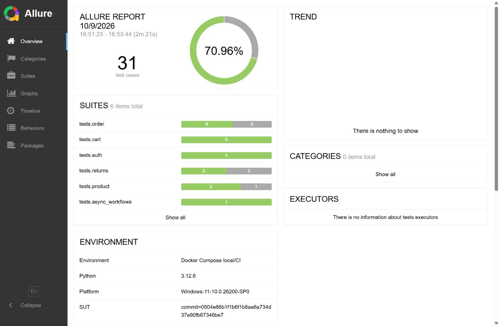
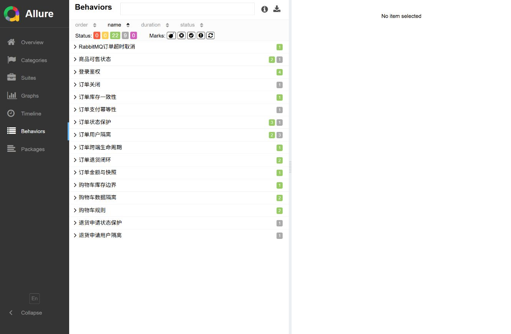

# 电商业务接口自动化测试

这是一个基于 `macrozheng/mall` 的个人接口测试项目，使用 Python、pytest 和 Requests 测试商城前台与管理后台的业务流程。Docker Compose 负责启动 MySQL、Redis、MongoDB、RabbitMQ 和两个商城服务，Allure 和 GitHub Actions 保存测试报告与执行结果。

## 项目目标

项目重点检查订单接口返回成功后，金额、库存和订单状态是否一致，用户能否操作别人的订单，以及超时消息是否真正触发取消并释放锁定库存。

测试沿着“购物车 → 创建订单 → 支付 → 后台发货 → 确认收货 → 退货”这条流程展开，也检查非法状态流转、重复支付和双用户隔离。被测商城固定使用一个开源版本，本仓库包含测试代码、环境配置、数据准备和验证报告。

## 实现思路

| 要解决的问题 | 实现方式 | 代码与文档 |
| --- | --- | --- |
| 多个场景重复登录、下单、完成订单 | 分离接口对象与业务工作流，使用 Fixture 提供前后台客户端和依赖 | [订单工作流](src/mall_api_test/workflows/order_workflow.py)、[Fixture](tests/conftest.py) |
| 接口返回正确，但数据库状态可能错误 | 同时断言响应、订单主表与明细、库存快照和操作历史 | [订单一致性测试](tests/order/test_order_consistency.py) |
| 用例修改商品、订单和超时设置，影响后续执行 | 使用专用账号与商品，在用例前后清理记录、恢复库存；超时设置在 `finally` 中恢复 | [测试数据管理](src/mall_api_test/repositories/test_data_manager.py)、[异步测试](tests/async_workflows/test_order_timeout.py) |
| 已知缺陷可能掩盖其他失败 | 使用 `xfail(strict=True, raises=KnownDefectError)`，只接受核实过的缺陷特征 | [越权测试](tests/order/test_order_ownership.py)、[框架自测](qa/test_known_defects.py) |
| 异步取消无法在请求返回时立即判断 | 通过真实 RabbitMQ 延迟消息触发取消，轮询订单状态并核对库存恢复 | [超时取消测试](tests/async_workflows/test_order_timeout.py) |

## 测试覆盖

- 登录鉴权：前后台登录、错误凭据、Token 身份、未登录访问。
- 商品与购物车：接口与数据库一致性、上下架、重复添加、数量更新、库存边界、双用户隔离。
- 订单与金额：确认订单、主表与明细金额、商品快照、锁定库存、取消释放库存。
- 跨端状态流转：前台创建与支付、后台发货、前台确认收货、后台关闭、非法流转保护、操作历史。
- 退货：完成订单申请退货、后台审核通过或拒绝、收货完成、删除拒绝申请。
- 异步取消：超时订单自动关闭及锁定库存释放。
- 读取负载实验：商品搜索、商品详情、购物车读取，校验 HTTP 与业务响应，区分轻量基线和阶梯实验。

完整回归共 35 个测试实例。[测试矩阵](docs/test-matrix.md)列出了具体场景，[测试策略](docs/test-strategy.md)说明了风险和断言的设计。

## 缺陷案例：订单关闭后仍占用库存

后台关闭待付款订单时，接口返回成功，订单状态变为已关闭，也能查到关闭历史。只检查这三个结果，用例就会通过。

加入库存断言后发现：SKU 的 `stock` 仍为 500，但 `lock_stock` 从下单前的 0 增加到 1，关闭订单后没有恢复。源码分析记录显示，后台 `close()` 更新了状态并写入历史，却没有像前台取消订单那样解锁库存。

该问题已记录在 [GH-7](https://github.com/dotyucun/mall-commerce-api-automation/issues/7)。回归用例同时检查订单、操作历史和库存，只有确认复现了这一缺陷，才将结果标为预期失败。测试结束后会恢复环境中的数据，但这不等于修复了后端问题。详见[复现步骤与源码路径](docs/issue-6-admin-close-stock.md)。

## 验证结果

以下是 2026-11-09 的本地功能回归结果，被测服务由固定上游提交的干净源码构建。历史性能基线另行标注日期，执行环境和详细结果见[实测结果](docs/results.md)。

| 项目 | 结果 |
| --- | --- |
| 被测版本 | `macrozheng/mall@0504e86b1f1b6f1b8aa6a734d37a90fb67346be7` |
| 普通回归 | 默认顺序连续两轮、逆序一轮，均为 `21 passed, 13 xfailed, 1 deselected` |
| 完整回归 | 整合版 `22 passed, 13 xfailed`，包含真实 RabbitMQ 超时取消，耗时 162.23 秒 |
| 框架自测 | Windows 下 `70 passed`，覆盖运行脚本、脱敏、数据写入边界、业务断言、xfail、阶梯窗口记账及证据审计；Linux CI 为 65 个 |
| Locust 历史基线（2026-10-09） | 20 用户、2 用户/秒、2 分钟；2190 请求、0 失败、聚合 P95 14ms；本次未重跑 |
| 静态检查 | Ruff check 与 format check 通过 |

13 个预期失败实例对应 8 类已确认的被测系统缺陷，其中 4 个新增实例检查购物车规格越权和非正数量。缺陷列表见[已知缺陷](docs/known-issues.md)，环境、统计和报告截图见[实测结果](docs/results.md)。云端结果请查看对应提交的 [Actions 记录](https://github.com/dotyucun/mall-commerce-api-automation/actions)。

### 2026-11-09 阶梯读取验证

阶梯工具和业务回归使用相同的配置、专用账号及 Compose 环境，都通过统一脚本运行；压测期间不同时运行功能回归。默认 10/20/40/80 用户各测量 60 秒，本次共完成 74261 个稳态请求、0 失败，80 用户档成功 RPS 为 656.78、P95 为 27ms。

测量窗口结束后才完成的 21 个尾部请求单独统计，没有失败或未完成请求。原始摘要、资源采样和源码指纹也已核对通过，详见[复核记录](docs/performance-review-20261109.md)。这轮结果只反映固定热点数据的读取表现，不能据此确定服务端容量上限。

### 历史阶梯读取实验（2026-10-16）

用户等待时间固定为 0.1 秒，每档预热 30 秒、稳态测量 60 秒，登录和预热请求不计入稳态统计。搜索、详情和购物车读取的任务权重为 3:2:1，使用一个专用会员和固定热点商品，这个比例不代表真实生产流量。

| 用户数 | 成功 RPS | 聚合 P95 | 稳态失败数 | 负载进程 CPU 中位数 |
| --- | --- | --- | --- | --- |
| 10 | 82.83 | 19ms | 0 | 11.0% |
| 20 | 169.67 | 22ms | 0 | 20.1% |
| 40 | 329.62 | 31ms | 0 | 33.2% |
| 80 | 589.30 | 51ms | 0 | 88.0% |
| 160 | 679.75 | 130ms | 0 | **97.1%，触发发生器门槛** |

80 用户档延长为两轮各 5 分钟，成功 RPS 分别为 582.17/582.32，P95 均为 55ms。第二轮的 174698 个请求中有 **1 次失败（0.00057%）**，报告保留了这次失败。160 用户复测再次触发负载进程 CPU 门槛，但吞吐和延迟与首轮差异明显，因此 **未确认服务端容量上限，320 用户未执行**。

这次实验没有修改商城源码，也没有完成服务端性能优化。新旧实验的等待模型不同，不能把 RPS 的差异当作优化收益。实验方法、失败记录、曲线和可供核对的原始数据见 [阶梯实验记录](docs/performance-20261016.md)，执行步骤见 [运行说明](docs/performance-steps.md)。

## 项目范围

商城业务源码来自上游，与本仓库的测试代码分别管理。支付场景调用的是商城内部订单状态接口，不是真实支付。当前范围也不包含 UI、完整优惠券与积分流程、后台权限 CRUD 和生产部署。

测试在隔离环境中使用专用账号和数据串行执行，端口只绑定本机。Locust 数字来自同机部署的读取基线和阶梯实验，尚未验证并发下单、库存竞争、生产容量和长时间稳定性。XFAIL 表示缺陷已复现，不计入通过或修复数量。

## 工程结构

```text
src/mall_api_test/
  api/             # mall-portal 与 mall-admin 接口对象
  workflows/       # 购物车、订单、退货业务编排
  repositories/    # 只读业务查询与受控测试数据写入
  common/          # HTTP、数据库、轮询、通用与领域断言
  config/          # YAML 默认值和环境变量覆盖
  models.py        # 跨步骤上下文和库存快照
tests/             # 按 auth/product/cart/order/returns/async 分域
docker/            # Compose、服务配置、测试种子数据
scripts/           # 一键启动、测试、报告、性能与清理
performance/       # Locust 基线、阶梯运行、独立资源采集与报告审计
docs/              # 架构、策略、矩阵、数据、缺陷与实测证据
```

详细分层规则见[架构说明](docs/architecture.md)，完整场景见[测试矩阵](docs/test-matrix.md)。

## 快速开始

前置环境：Git、Java 17、Maven、Python 3.12、Docker Desktop。Windows 运行脚本可使用 PowerShell 5.1 或 7，CI 使用 PowerShell 7。Allure 2.24.0 仅在本地生成 HTML 时需要。

```powershell
git clone https://github.com/dotyucun/mall-commerce-api-automation.git
cd mall-commerce-api-automation
Copy-Item .env.example .env
```

在 `.env` 中填写本地专用密码，`bootstrap` 会用这些值初始化管理员和两个专用会员的密码，无需知道上游演示密码。仓库不保存真实凭据，YAML 中只有非敏感默认值。测试账号密码必须为 1 至 72 个 UTF-8 字节。

```powershell
powershell -NoProfile -ExecutionPolicy Bypass -File .\scripts\mall-test.ps1 bootstrap
powershell -NoProfile -ExecutionPolicy Bypass -File .\scripts\mall-test.ps1 test
powershell -NoProfile -ExecutionPolicy Bypass -File .\scripts\mall-test.ps1 report
```

`bootstrap` 会拉取固定 mall commit，构建两个 JAR，安装测试依赖和本地测试包，启动六个 Compose 服务，等待健康检查通过，再初始化专用凭据和测试数据。再次执行会恢复测试数据基线，不要在测试运行期间执行。

端口为后台 8080、前台 8085、MySQL 13307、Redis 6379、MongoDB 27017、RabbitMQ 5672/15672。如果端口被占用，先确认是哪个服务，不要随意结束其他项目的进程。

其他命令：

```powershell
powershell -NoProfile -ExecutionPolicy Bypass -File .\scripts\mall-test.ps1 status
powershell -NoProfile -ExecutionPolicy Bypass -File .\scripts\mall-test.ps1 full
powershell -NoProfile -ExecutionPolicy Bypass -File .\scripts\mall-test.ps1 slow
powershell -NoProfile -ExecutionPolicy Bypass -File .\scripts\mall-test.ps1 verify
powershell -NoProfile -ExecutionPolicy Bypass -File .\scripts\mall-test.ps1 performance
powershell -NoProfile -ExecutionPolicy Bypass -File .\scripts\mall-test.ps1 performance-steps -PerformanceProfile explore
powershell -NoProfile -ExecutionPolicy Bypass -File .\scripts\mall-test.ps1 stop
powershell -NoProfile -ExecutionPolicy Bypass -File .\scripts\mall-test.ps1 down
```

`test` 排除 slow；`full` 包含 RabbitMQ 慢用例；`verify` 只读检查测试数据的清理情况、库存和消息队列。`stop` 停止服务，`down` 删除本项目的容器和网络，但保留数据卷。测试只支持在隔离的 Compose 环境中串行运行，不支持共享环境下的多进程并发，也不能连接生产数据库或共享生产消息队列。

所有服务端口只绑定宿主机 `127.0.0.1`，不向局域网开放。固定版本是为了复现测试，不建议据此部署生产环境。

独立框架自测不需要被测服务：

```powershell
python -m pytest qa -o addopts= -q
```

如果已在当前 PowerShell 会话中导出 `.env` 里的凭据，可以直接按 marker 执行。否则请使用统一脚本，由脚本加载 `.env`：

```powershell
python -m pytest -m "smoke"
python -m pytest -m "e2e and not slow"
python -m pytest -m "known_issue"
```

## 报告证据

以下是 2026-10-09 保存的截图，当时有 31 个实例，尚不包含后来新增的用例。当前共 35 个实例，请以上面的实测结果和对应提交的 Actions 产物为准。





执行环境、限制和原始统计见[实测结果](docs/results.md)。GitHub Actions 会上传完整运行产物，`reports/`、缓存、JAR 和日志不提交到仓库。`docs/evidence/` 中保留了经过审阅的小型性能证据副本，方便日后核对 README 中的数字。

Allure 将 XFAIL 显示为灰色 `skipped`。历史截图中的 9 条是当时已执行并关联 Issue 的缺陷用例，当前为 13 条。环境、数据恢复和交付检查见[核验记录](docs/final-audit.md)。

## CI

- PR：Ruff、框架自测、收集检查、非 slow 回归、Allure HTML、容器日志。
- main 与手动触发：同样的检查加完整回归，包含 slow。
- 每周及手动触发：RabbitMQ 订单超时慢用例。
- 仅手动触发：Locust 轻量基线，或独立的 smoke/explore/confirm 阶梯实验；不同运行环境的数值不混用。

业务回归会从固定 mall commit 构建真实服务；框架自测则隔离外部依赖，检查测试工具本身。
