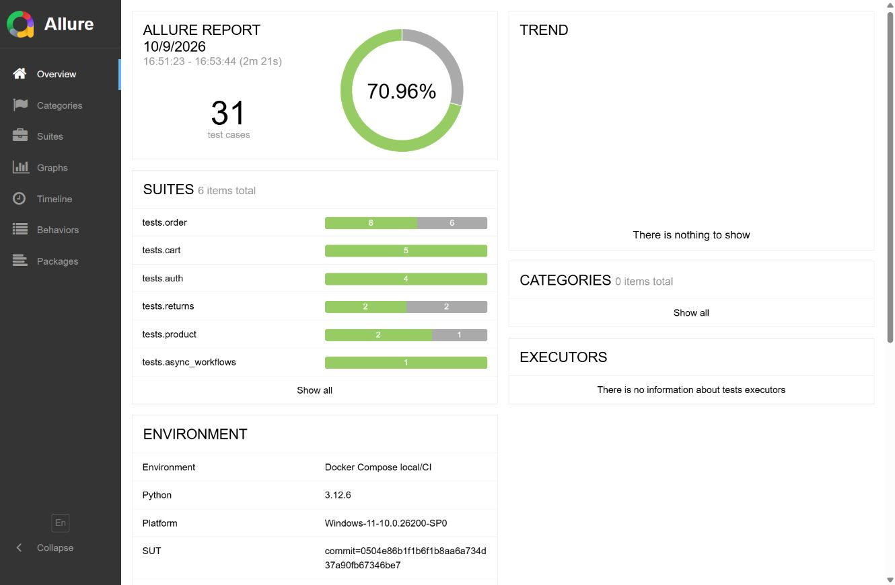
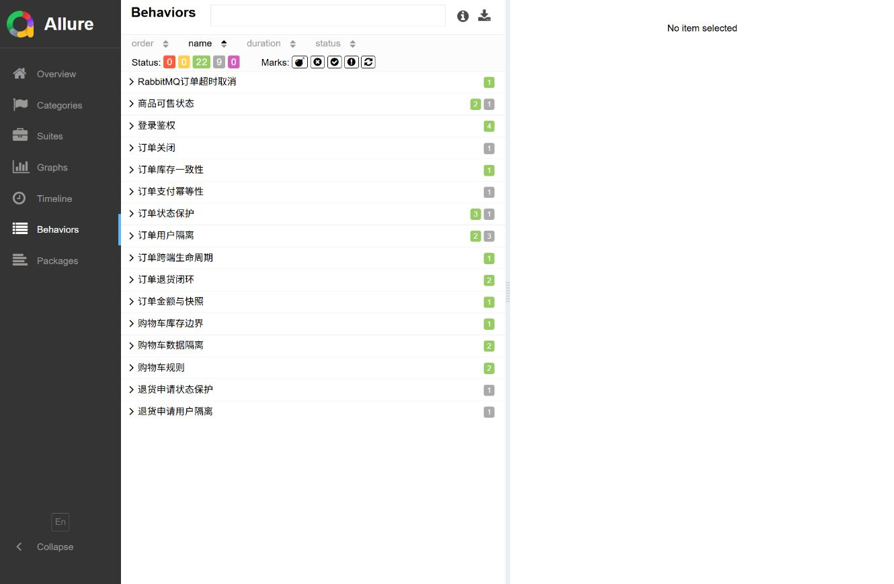

# 电商业务接口自动化测试

基于 `macrozheng/mall` 的个人测试工程，使用 Python、pytest 和 Requests 验证商城前台与管理后台的业务流程。测试环境由 Docker Compose 启动，覆盖 MySQL、Redis、MongoDB、RabbitMQ 和两个商城服务，结果通过 Allure 报告和 GitHub Actions 保存。

## 项目目标

订单接口返回成功后，金额、库存和订单状态是否一致？用户能否操作别人的订单？订单超时后，消息队列是否真正触发取消并释放锁定库存？这些是本项目重点验证的问题。

测试以“购物车 → 创建订单 → 支付 → 后台发货 → 确认收货 → 退货”为主线，同时覆盖非法状态流转、重复支付和双用户隔离。被测商城采用固定的开源版本，本仓库负责测试代码、环境配置、数据准备和验证报告。

## 实现思路

| 要解决的问题 | 实现方式 | 代码与文档 |
| --- | --- | --- |
| 多个场景重复登录、下单、完成订单 | 分离接口对象与业务工作流，使用 Fixture 提供前后台客户端和依赖 | [订单工作流](src/mall_api_test/workflows/order_workflow.py)、[Fixture](tests/conftest.py) |
| 接口返回正确，但数据库状态可能错误 | 同时断言响应、订单主表与明细、库存快照和操作历史 | [订单一致性测试](tests/order/test_order_consistency.py) |
| 用例修改商品、订单和超时设置，影响后续执行 | 使用专用账号与商品，在用例前后清理记录、恢复库存；超时设置在 `finally` 中恢复 | [测试数据管理](src/mall_api_test/repositories/test_data_manager.py)、[异步测试](tests/async_workflows/test_order_timeout.py) |
| 已知缺陷可能掩盖其他失败 | 使用 `xfail(strict=True, raises=KnownDefectError)`，只接受核实过的缺陷特征 | [越权测试](tests/order/test_order_ownership.py)、[框架自测](qa/test_known_defects.py) |
| 异步取消无法在请求返回时立即判断 | 通过真实 RabbitMQ 延迟消息触发取消，轮询订单状态并核对库存恢复 | [超时取消测试](tests/async_workflows/test_order_timeout.py) |

## 测试覆盖

- 登录鉴权：前后台登录、错误凭据、Token 身份、未登录访问。
- 商品与购物车：接口与数据库一致性、上下架、重复添加、数量更新、库存边界、双用户隔离。
- 订单与金额：确认订单、主表与明细金额、商品快照、锁定库存、取消释放库存。
- 跨端状态流转：前台创建与支付、后台发货、前台确认收货、后台关闭、非法流转保护、操作历史。
- 退货：完成订单申请退货、后台审核通过或拒绝、收货完成、删除拒绝申请。
- 异步取消：超时订单自动关闭及锁定库存释放。
- 性能基线：商品搜索、商品详情、购物车读取，以及 HTTP 和业务响应校验。

完整回归共 31 个测试实例，具体场景见[测试矩阵](docs/test-matrix.md)，风险与断言设计见[测试策略](docs/test-strategy.md)。

## 缺陷案例：订单关闭后仍占用库存

后台关闭待付款订单时，接口成功、订单状态变为已关闭、关闭历史也存在。如果只检查这三个结果，该场景会通过。

补充库存断言后，SKU 的 `stock` 仍为 500，但 `lock_stock` 从下单前的 0 增加到 1，关闭订单后没有恢复。仓库中的源码分析记录显示，后台 `close()` 更新状态并写入历史，没有执行前台取消路径中的库存解锁操作。

该问题登记为 [GH-7](https://github.com/dotyucun/mall-commerce-api-automation/issues/7)，回归用例保留订单、历史和库存的联合检查，并在核实该缺陷表现时产生预期失败。测试后的数据清理负责恢复实验环境，后端缺陷仍需单独修复。详见[复现步骤与源码路径](docs/issue-6-admin-close-stock.md)。

## 验证结果

以下统计来自 2026-10-09 的本地实测，执行环境与原始结果见[实测结果](docs/results.md)。

| 项目 | 结果 |
| --- | --- |
| 被测版本 | `macrozheng/mall@0504e86b1f1b6f1b8aa6a734d37a90fb67346be7` |
| 普通回归 | 默认与逆序各运行一次，均为 `21 passed, 9 xfailed, 1 deselected` |
| 完整回归 | `22 passed, 9 xfailed`，包含真实 RabbitMQ 超时取消 |
| RabbitMQ 慢用例 | 单独运行 `1 passed, 30 deselected`，约 61 秒 |
| 框架自测 | Windows 下 `35 passed`，覆盖运行脚本、响应脱敏、数据写入边界、性能业务断言及 xfail 行为 |
| Locust 基线 | 20 用户、2 用户/秒、2 分钟；2190 请求、0 失败、聚合 P95 14ms |
| 静态检查 | Ruff check 与 format check 通过 |

9 个预期失败实例对应 6 类已确认的被测系统缺陷。缺陷列表见[已知缺陷](docs/known-issues.md)，环境、统计和报告截图见[实测结果](docs/results.md)。各次云端执行以对应提交的 [Actions 记录](https://github.com/dotyucun/mall-commerce-api-automation/actions)为准。

## 项目范围

本项目展示基于开源商城的接口测试实践；商城业务源码来自上游，测试工程与被测服务分别管理。支付场景调用商城内部订单状态接口；当前测试范围不包含 UI、真实支付、完整优惠券与积分、后台权限 CRUD 和生产部署。

测试使用仅绑定本机端口的隔离环境，专用账号与数据串行执行。Locust 数字是单机读取基线，尚未验证并发下单、库存竞争、生产容量和长时间稳定性。XFAIL 表示缺陷已复现，仍不计入通过或修复数量。

## 工程结构

```text
src/mall_api_test/
  api/             # mall-portal 与 mall-admin 接口对象
  workflows/       # 购物车、订单、退货业务编排
  repositories/    # 只读业务查询与受控测试数据写入
  common/          # HTTP、数据库、轮询、通用与领域断言
  config/          # YAML 默认值和环境变量覆盖
  models.py        # 跨步骤上下文和库存快照
tests/             # 按 auth/product/cart/order/returns/async 分域
docker/            # Compose、服务配置、测试种子数据
scripts/           # 一键启动、测试、报告、性能与清理
performance/       # Locust 基线任务
docs/              # 架构、策略、矩阵、数据、缺陷与实测证据
```

详细分层规则见[架构说明](docs/architecture.md)，完整场景见[测试矩阵](docs/test-matrix.md)。

## 快速开始

前置环境：Git、Java 17、Maven、Python 3.12、Docker Desktop。Windows 运行脚本可使用 PowerShell 5.1 或 7，CI 使用 PowerShell 7。Allure 2.24.0 仅在本地生成 HTML 时需要。

```powershell
git clone https://github.com/dotyucun/mall-commerce-api-automation.git
cd mall-commerce-api-automation
Copy-Item .env.example .env
```

在 `.env` 中填写本地专用密码。`bootstrap` 将管理员和两个专用会员的密码初始化为这些值，不要求知道上游演示密码。仓库不保存真实凭据，YAML 只保存非敏感默认值。测试账号密码必须为 1 至 72 个 UTF-8 字节。

```powershell
powershell -NoProfile -ExecutionPolicy Bypass -File .\scripts\mall-test.ps1 bootstrap
powershell -NoProfile -ExecutionPolicy Bypass -File .\scripts\mall-test.ps1 test
powershell -NoProfile -ExecutionPolicy Bypass -File .\scripts\mall-test.ps1 report
```

`bootstrap` 会拉取固定 mall commit、构建两个 JAR、安装测试依赖和本地测试包、启动六个 Compose 服务、等待健康检查，并初始化专用凭据和测试数据。重新执行会恢复测试数据基线，因此不要在测试运行期间执行。端口为后台 8080、前台 8085、MySQL 13307、Redis 6379、MongoDB 27017、RabbitMQ 5672/15672；若占用，先确认占用服务，不要随意结束其他项目进程。

其他命令：

```powershell
powershell -NoProfile -ExecutionPolicy Bypass -File .\scripts\mall-test.ps1 status
powershell -NoProfile -ExecutionPolicy Bypass -File .\scripts\mall-test.ps1 full
powershell -NoProfile -ExecutionPolicy Bypass -File .\scripts\mall-test.ps1 slow
powershell -NoProfile -ExecutionPolicy Bypass -File .\scripts\mall-test.ps1 verify
powershell -NoProfile -ExecutionPolicy Bypass -File .\scripts\mall-test.ps1 performance
powershell -NoProfile -ExecutionPolicy Bypass -File .\scripts\mall-test.ps1 stop
powershell -NoProfile -ExecutionPolicy Bypass -File .\scripts\mall-test.ps1 down
```

`test` 排除 slow；`full` 包含 RabbitMQ 慢用例；`verify` 只读检查测试数据清理、库存和消息队列。`stop` 停止服务，`down` 删除本项目容器及网络但保留数据卷。测试只能在隔离的 Compose 环境中串行运行，不支持共享环境多进程并发，更不能指向生产数据库或共享生产消息队列。

所有服务端口仅绑定宿主机 `127.0.0.1`，不向局域网开放。固定版本用于复现测试，不是生产环境部署建议。

独立框架自测不需要被测服务：

```powershell
python -m pytest qa -o addopts= -q
```

如果已在当前 PowerShell 会话中导出 `.env` 里的凭据，也可直接按 marker 执行；否则应使用统一脚本，让脚本负责加载 `.env`：

```powershell
python -m pytest -m "smoke"
python -m pytest -m "e2e and not slow"
python -m pytest -m "known_issue"
```

## 报告证据





完整执行环境、限制与原始统计见[实测结果](docs/results.md)。GitHub Actions 会上传 Allure 原始结果、HTML、容器日志和 Locust HTML/CSV，不把生成物提交进源码仓库。

Allure 将 XFAIL 显示为灰色 `skipped`；截图中 9 条对应已经执行并关联 Issue 的缺陷用例。环境、数据恢复和交付检查见[核验记录](docs/final-audit.md)。

## CI

- PR：Ruff、框架自测、收集检查、非 slow 回归、Allure HTML、容器日志。
- main 与手动触发：同样的检查加完整回归，包含 slow。
- 每周及手动触发：RabbitMQ 订单超时慢用例。
- 仅手动触发：Locust 轻量性能基线。

业务回归工作流从固定 mall commit 构建真实服务；框架自测使用隔离依赖的方式验证测试工具自身。
