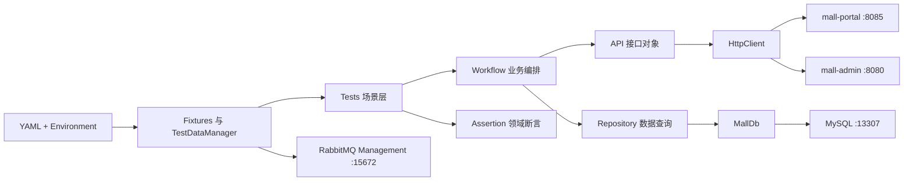

# 架构说明

## 设计目标

订单、退货和越权测试需要反复执行登录、下单、支付等准备步骤。把这些步骤集中到接口对象与业务工作流后，场景文件可以直接表达要验证的行为，接口路径或公共流程变化时也有明确的修改位置。

接口调用、数据库查询、断言和测试数据恢复分别承担不同职责。下面的结构用于组织这些依赖，具体边界见分层职责表。

## 分层职责

| 层 | 责任 | 禁止事项 |
| --- | --- | --- |
| API | 定义现有接口路径、参数和响应契约 | 不编排跨接口业务，不直接查库 |
| Workflow | 组合购物车、订单、退货的可复用步骤 | 不写 SQL，不读取环境变量 |
| Repository | 查询数据库事实；TestDataManager 受控写入测试数据 | 普通 Repository 不修改业务数据 |
| Assertion | 业务码、金额、库存和订单一致性断言 | 不发请求，不产生测试数据 |
| Fixture | 客户端登录、依赖注入、场景前后清理 | 不依赖用例执行顺序 |
| Test data | 专用会员、地址、商品与恢复策略 | 不复用人工账号和随机线上数据 |

## 实现选择

### 接口对象与工作流分别封装

接口对象对应 mall 的现有路径、参数和响应；工作流组合多个接口完成下单、完成订单或申请退货等步骤。负向场景保留直接调用接口的入口，用于检查非法操作的响应和副作用。这样既能复用正常流程，也能单独验证流程中的某一步。

### 响应与数据库结果一起检查

接口响应用于判断调用结果，Repository 提供订单、明细、库存和历史记录等持久化事实。例如后台关闭场景，订单状态与操作历史都正确，库存检查却暴露了锁定库存未释放的问题。数据库断言补充的是业务结果，而非替代真实接口调用。

### 测试数据集中恢复

商品上下架、库存和订单记录会影响后续场景，因此使用专用数据并在用例前后恢复。数据库写入集中在 `TestDataManager`，普通 Repository 提供查询。该方式依赖隔离环境和串行执行，共享同一 SKU 的并发测试需要额外的数据隔离设计。

### 已知缺陷保留失败特征

`strict=True` 使缺陷修复后的意外通过触发 CI 失败；`raises=KnownDefectError` 将可接受的预期失败限定为专用异常。用例先核对准备条件、响应和数据库变化，再在确认缺陷特征时抛出异常。框架自测分别检查已知缺陷、无关断言、准备阶段故障和后端修复四种结果。

## 关键类型

- `Settings`：把 YAML 默认值与环境变量覆盖转换为强类型配置，并集中检查必需凭据。
- `OrderContext`：保存一次订单链路中的订单、购物车、商品、SKU、地址和金额信息。
- `StockSnapshot`：用不可变快照比较 `stock` 与 `lock_stock` 的前后变化。
- `ReturnContext`：保存退货申请编号、金额和订单关联信息。

## HTTP 与证据

`HttpClient` 统一处理请求超时、HTTP 状态、JSON 解析和交换记录；记录中的请求参数与响应内容经过脱敏。业务码与业务结果由接口对象和场景断言继续检查，金额、库存和操作历史通过数据库查询核对。

## 环境边界

本仓库不复制 mall 源码。`bootstrap` 将源码克隆到被忽略的 `.sut/mall`，校验 commit 后构建 JAR，再挂载进 Compose 的 Java 17 容器。这样可以复现被测版本，同时避免把第三方源码、JAR 和数据库卷提交到测试仓库。
