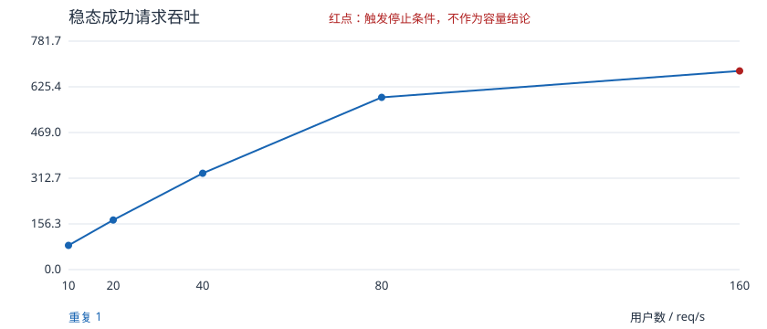
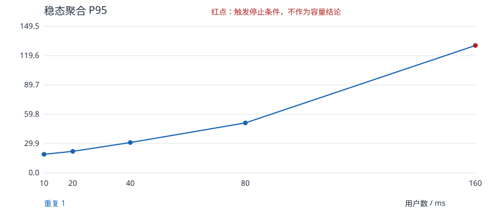

# 2026-10-16 阶梯读取实验记录

## 问题与实验边界

旧基线的 20 用户包含 0.5～1.5 秒等待，请求速率主要受用户节奏限制，不能据此声称系统的最大吞吐能力。本轮将等待固定为 0.1 秒，逐档增加负载，分别统计稳态窗口，并监测压测端及被测容器资源。

被测源码固定为 `0504e86b1f1b6f1b8aa6a734d37a90fb67346be7`，复用本地已有 JAR，本轮没有修改商城源码。工作负载复用现有 Locust 任务：商品搜索、商品详情、购物车读取，权重为 3:2:1。每个虚拟用户独立会话，但使用同一专用会员、固定商品和搜索关键词。登录发生在测量窗口之外。

本轮是固定热点、小数据集、闭环用户模型的本地实验，不代表真实生产流量，也没有测下单与支付容量。随着响应变慢，闭环用户自身的请求发送速率也会下降，不能把用户数直接换算成固定到达率。

## 本地环境

- Windows 11，Python 3.12.6；Locust 2.42.6、psutil 7.2.2。
- 宿主机 32 个逻辑 CPU、约 63.8 GiB 内存；Docker VM 32 个 CPU、约 31.2 GiB 内存。
- MySQL 5.7、Redis 7、MongoDB 5、RabbitMQ 3.10.5，以及 mall-admin、mall-portal；Compose 没有给每个容器设置独立 CPU/内存限额。
- 负载进程和被测服务位于同一台机器；其他学习项目的容器保持运行，具体清单保存在环境元数据中。不能将本机结果外推到独占服务器。
- 目标为 `http://127.0.0.1:8085`。排查时，同一健康接口新建连接使用 `localhost` 连续三次约为 2094/2091/2070ms，使用 IPv4 约为 9/31/32ms。本机 `localhost` 同时解析 IPv4/IPv6，而 Compose 只绑定 IPv4。这是可重复的传输路径差异，不是商城容量结论；正式阶段明确使用 IPv4。

## 阶梯探索

执行等待 0.1 秒、每秒启动 10 用户，各档全体登录成功后预热 30 秒、稳态 60 秒。计划档位为 10/20/40/80/160/320；160 用户触发压测进程 CPU 门槛后自动停止，因此 **320 用户未执行**。

| 用户 | 稳态请求数 | 成功 RPS | 聚合 P95 | 聚合 P99 | 失败数 | 压测进程 CPU 中位数 |
| --- | --- | --- | --- | --- | --- | --- |
| 10 | 4970 | 82.83 | 19ms | 22ms | 0 | 11.0% |
| 20 | 10180 | 169.67 | 22ms | 27ms | 0 | 20.1% |
| 40 | 19777 | 329.62 | 31ms | 40ms | 0 | 33.2% |
| 80 | 35358 | 589.30 | 51ms | 69ms | 0 | 88.0% |
| 160 | 40785 | 679.75 | 130ms | 160ms | 0 | **97.1%，触发停止** |

以上 CPU 是 psutil 对负载进程的单核口径，不是整机 CPU 占用率。160 用户时，采样中的负载进程 CPU 为 96.0%～98.2%；mall-portal 容器为 212%～282%（多核口径），MySQL 容器为 65%～87%。不能直接把容器百分比和单核发生器百分比当成相同含义。

从 80 到 160 用户，成功吞吐只增长约 15.3%，P95 从 51ms 升至 130ms，表面上存在曲线弯折。但由于发生器同时接近单核饱和，这一档标记为 `generator_cpu_limit`，不作为被测系统容量或服务端瓶颈证据。MySQL 锁等待计数在该阶段采样中为 0，同样不能据此排除其他数据库瓶颈。

窗口发起/完成账目核对：40 用户有 16 个尾部完成请求，160 用户有 52 个；其余三档为 0。所有档位未完成请求和尾部失败均为 0。尾部数据不混入稳态 RPS/分位数，也没有被默认为稳态成功。

原始探索记录：`reports/locust/steps/20261016T104804536360Z/`；已审阅副本见 [探索 CSV](evidence/performance-20261016/explore/campaign.csv)、[HTML 报告](evidence/performance-20261016/explore/index.html) 和同目录的阶段、资源及环境记录。

## 持续验证与复测

80 用户每轮预热 30 秒、稳态 300 秒，共两轮：

| 轮次 | 稳态请求数 | 失败数 | 成功 RPS | 平均耗时 | P95 | P99 | 失败率 | 负载进程 CPU 中位数 |
| --- | --- | --- | --- | --- | --- | --- | --- | --- |
| 1 | 174651 | 0 | 582.17 | 23.01ms | 55ms | 73ms | 0% | 80.6% |
| 2 | 174698 | **1** | 582.32 | 23.12ms | 55ms | 75ms | **0.00057%** | 80.1% |

两轮均未触发本实验停止门槛；这不等于“完全无错误”。第二轮商品详情出现一次 `CatchResponseError('HTTP status 0')`。Locust 2.42.6 在传输异常占位响应中将 `status_code` 设为 0，它不是服务端的 HTTP 响应码。本次失败摘要没有保留底层异常类别；对应稳态时段的 portal 标准输出也未检索到 ERROR/WARN/Exception 行，尚不能确定失败根因，不能推断为超时、服务端缺陷或本机偶发错误。

两轮各有 13 个窗口结束后完成的尾部请求，无尾部失败、无未完成请求。原始记录：`reports/locust/steps/20261016T105752054880Z/`；公开副本见 [确认 CSV](evidence/performance-20261016/confirm/campaign.csv)、[失败摘要](evidence/performance-20261016/confirm/repeat-2-users-80/summary.json)。不平均两个 P95，也不删除有一次失败的第二轮。

随后独立复测 160 用户（预热 30 秒、稳态 60 秒）：56618 请求、0 失败、943.63 成功 RPS、P95 68ms，负载进程 CPU 中位数 **98.8%**，再次触发停止门槛。尾部完成 48 个，无未完成请求。见 [复测 CSV](evidence/performance-20261016/generator-recheck/campaign.csv)。

160 用户两次结果的 RPS 和 P95 差异明显，但发生器 CPU 门槛重复出现。因此可以确认“当前单进程负载配置在该档位不适合作为服务端容量证据”，不能确认“商城稳定上限约 680 RPS”或“稳定上限约 944 RPS”。80 用户两轮只支持当前热点读取场景在这两次 5 分钟测量中的表现，不能证明长期稳定性。





## 本轮结论

- 10～80 用户探索阶段未确认服务端吞吐拐点；80 用户两轮 5 分钟的成功吞吐均约 582 RPS，P95 均为 55ms，第二轮有 1 次失败。
- 更高负载先出现发生器单核 CPU 饱和信号，主动停止后续 320 用户阶段。观察到曲线弯折，但没有把发生器受限误写成商城容量上限，也没有定位或修复服务端性能瓶颈。
- 若继续寻找服务端上限，应先将发生器迁到独立机器，核对其 CPU、调度和网络能力，再做分布式/多进程加压及服务端关联诊断。本轮未实施这些工作。
- 新旧实验等待时间、统计窗口和端点样本口径不同，不能将旧基线约 19 RPS 与本轮约 582 RPS 描述为“性能优化提升 30 倍”。

## 如何复核

执行方法和停止规则见 [阶梯实验说明](performance-steps.md)。原始目录包含配置、环境、源文件 SHA256、每档端点计数、分项耗时、失败记录、请求核算及资源/数据库采样。

`performance.audit` 核对阶段与总表、端点计数汇总、窗口秒数、RPS 分母、请求发起/完成账目、资源样本和生成器 CPU 摘要；源文件校验是独立的可选步骤。审计通过只证明保存数据内部一致，不等于证明商城容量。

```powershell
python -m performance.audit docs/evidence/performance-20261016/explore
python -m performance.audit docs/evidence/performance-20261016/confirm
python -m performance.audit docs/evidence/performance-20261016/generator-recheck
```

三组审计分别为 5/2/1 个阶段、111070/349349/56618 个稳态请求，均通过。执行时另加 `--source-root .` 核验了环境记录中的 SHA256；后续源码变化后，这个可选检查应在对应历史版本上运行，而不是关闭校验来宣称源码匹配。探索对应基线提交加环境文件中的工作副本指纹；确认与复测使用提交 `cc7da94`，具体全长提交号与指纹均保存在环境记录中。

本轮性能代码仅增加独立入口，不改旧基线的等待参数。公开证据是原始目录中 JSON/CSV/HTML/SVG 的小型副本，不包含 `.env`、Token、请求头、数据库凭据或容器日志。

## 回归与数据恢复

性能任务全部结束后再运行完整业务回归：`22 passed, 9 xfailed in 150.95s`，包含真实 RabbitMQ 超时取消；没有在压测过程中并行执行业务回归。9 个 XFAIL 为原有已知缺陷实例，不计为通过。

新增统计与报告检查后，Windows 独立框架自测为 `70 passed`；Ruff check、format check 通过。三组性能证据的源文件指纹及内部一致性审计均通过。图表审阅修正了极低失败率被两位小数显示成零的问题，现在同时显示失败次数和五位小数百分比。

性能结束后及完整回归结束后，各执行一次只读数据核验，均为：专用购物车/订单/退货记录 0，商品上架，SKU `stock`（实际库存）=500、`lock_stock`（锁定库存）=0，延迟消息 0，订单超时设置 120 分钟。
