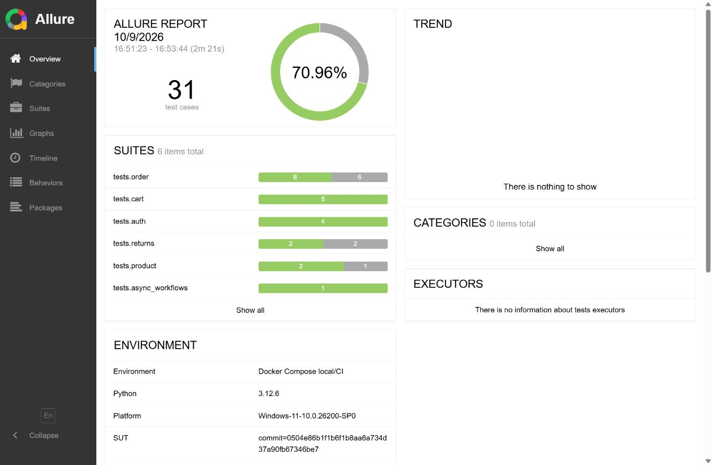
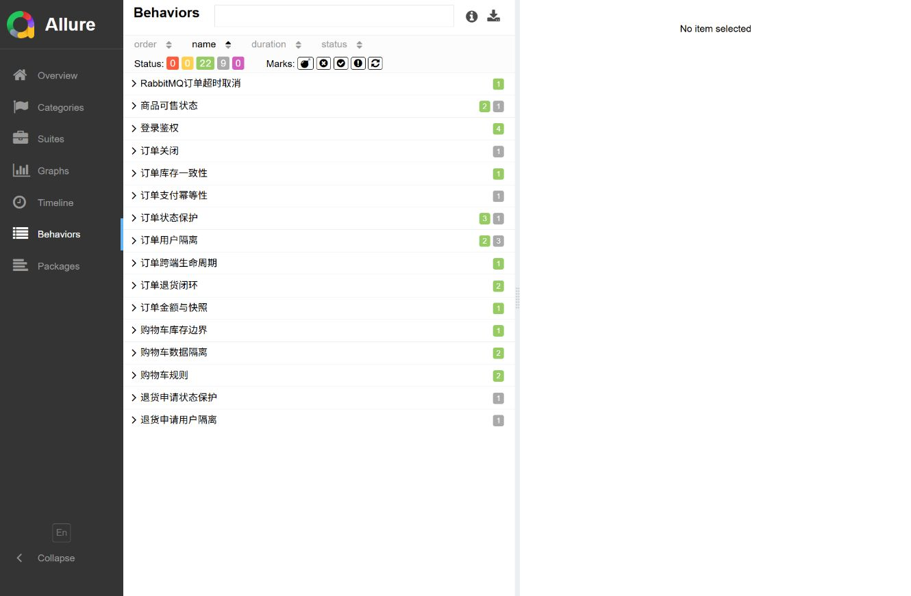

# 实测结果

本页记录 2026-11-09 的功能回归；Locust 基线和截图保留自 2026-10-09，分别标注，不将历史实验写成本次执行。

阶梯读取实验已纳入统一测试工程。2026-10-16 的探索、长窗口确认和发生器限制见[历史实验记录](performance-20261016.md)；2026-11-09 的 smoke、10/20/40/80 用户探索和证据核算见[复核记录](performance-review-20261109.md)。两次实验的数字不混用。

## 执行环境

- Windows 本地宿主机，Python 3.12、Java 17、Maven、Docker Desktop。
- Compose：MySQL 5.7、Redis 7、MongoDB 5、RabbitMQ 3.10.5、mall-admin、mall-portal。
- 被测源码：`macrozheng/mall@0504e86b1f1b6f1b8aa6a734d37a90fb67346be7`。
- Allure CLI：2.24.0。

本轮检查发现原有本地 SUT 工作区含未提交的后端修改，因此保留原目录，另建固定提交的干净 Git worktree，重新构建并挂载 JAR。下表仅统计切换后的执行，不包括最初在旧 JAR 上的探测结果。容器内 portal JAR 与新构建文件的 SHA256 一致：`189fe1a125c310c97d8435fbd1db75198bee6d3d09e4553379c2de1998b8deea`。该哈希标识本次构建产物，不是上游发布包校验值。

## 功能回归

非 slow 回归按默认顺序连续运行两次，再逆序运行一次，结果一致：

```text
21 passed, 13 xfailed, 1 deselected
```

13 个 xfail 是 8 类已确认缺陷产生的测试实例，不计为通过。完整测试收集为 35 个实例；本次新增 GH-11 购物车规格越权和 GH-12 非正数量的 4 个实例，详见[复现证据](cart-defects.md)。没有其他失败或错误。

性能工具与业务测试整合后，包含 RabbitMQ 慢场景的完整回归：

```text
22 passed, 13 xfailed in 162.23s
```

慢场景临时将订单超时设为 1 分钟，通过真实 RabbitMQ 消息和轮询验证取消及锁定库存释放，随后恢复执行前的设置。清理专用延迟队列避免旧长延迟消息导致队头阻塞。

默认两轮耗时分别为 102.95 秒、94.40 秒；逆序为 94.14 秒。耗时为当次本地环境观测值，不构成执行时长保证。用例前后会重置共享专用数据，因此该结果只证明所测的串行顺序可重复，不能证明并行安全，也不能证明用例无需数据重置即可独立运行。

性能工具整合前的业务框架自测为 `35 passed in 11.32s`。整合阶梯运行、窗口记账、报告和审计自测后，Windows 为 `70 passed in 14.04s`，Linux CI 共 65 个；差异来自 PowerShell 5.1/7 命令退出校验。这些自测不计入 35 个电商业务实例。Python 文件共 80 个，Ruff check 与 format check 均通过。

只读数据检查结果：专用购物车/订单/退货记录均为 0；商品为上架状态；SKU `stock=500`、`lock_stock=0`；延迟队列消息为 0；订单超时恢复为执行前的 120 分钟。

## Locust 历史基线（2026-10-09）

以下数字保留自历史记录，本次没有重跑此项性能实验，不能用本次功能回归日期替代性能实验日期。

```text
users: 20
spawn rate: 2 users/s
duration: 2 minutes
requests: 2190
failures: 0
throughput: 19.11 req/s
aggregate average: 8.89 ms
aggregate P95: 14 ms
maximum: 159.94 ms
```

统计包含 20 次登录和商品搜索、详情、购物车读取。搜索/详情/购物车 P95 分别为 12/14/8ms，登录 P95 为 160ms。每个请求同时校验 HTTP、业务码及关键数据；不把 HTTP 200 自动计为业务成功。

这里的 2 分钟是命令配置时长。Locust 2.42.6 的聚合 RPS 使用 `last_request_timestamp - start_time` 作为分母，不应直接用 `2190 / 120` 复算成同一个指标；本轮没有重建历史开始/结束时间。新阶梯入口改为记录明确的稳态窗口，使用该窗口秒数计算 RPS。

该数字来自单机本地 Docker 环境，只作为后续变更的对照基线，不代表生产容量，也未证明并发下单、真实支付、资源瓶颈或长时间稳定性。

## 历史报告截图（2026-10-09）





截图来自 2026-10-09 的完整回归：31 个实例、22 passed、9 skipped（pytest 的已确认缺陷 XFAIL）、0 failed、0 broken。它们不包含本次新增的 4 个购物车实例，不作为当前 35 个实例的统计依据。其他历史 PNG 同样仅保留作旧版记录。

GitHub Actions 中保存 Allure 原始结果、HTML 和容器日志，避免仅保留截图而丢失可审计证据。
